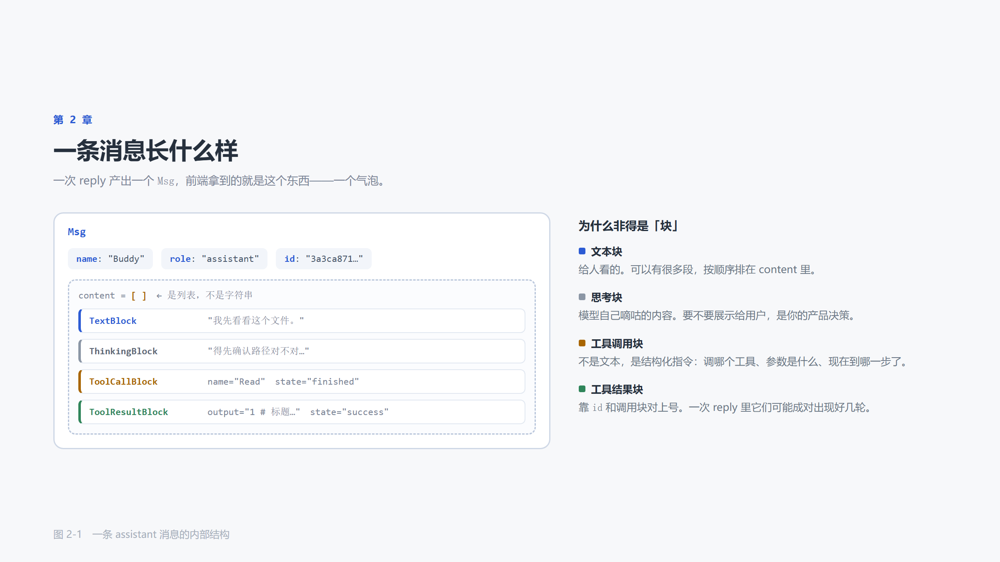
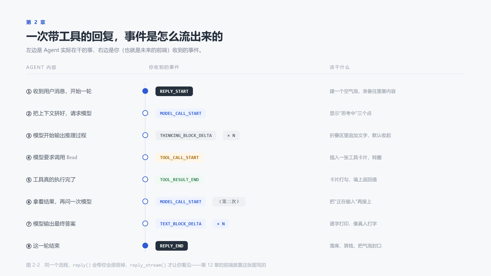

# 第 2 章　读懂一次对话：Msg / Block / Event

> 本章代码 `code/ch02/main.py`、`code/ch02/inspect_msg.py`　·　读完约 15 分钟

## 2.0 上一章的 print 省略了太多信息

上一章那个循环里，每轮也只打了一行：

```python
print(reply.get_text_content())
```

把一个完整对象压缩成一个字符串，只为读取一句话。

但 `reply` 承载的信息远不止一句话：这一轮里模型推理了什么、调用了哪个工具、工具返回了什么、消耗了多少 token。这些内容都被 `get_text_content()` 一次性丢弃了。

那么本章，我们要一起来做两件事：看清一条消息的结构，看懂一次回复的过程。

前者决定数据如何存储，后者决定界面如何编写。

## 2.1 `Msg`：一条消息的结构

`Msg` 是 AgentScope 中最基础的数据结构。一次用户输入是一个 `Msg`，一次完整回复也是一个 `Msg`

它有 11 个字段，但真正需要关注的只有 4 个：

| 字段 | 类型 | 作用 | 是否需要手动处理 |
|---|---|---|---|
| `name` | `str` | 发送方名称 | 是 |
| `role` | `"user" \| "assistant" \| "system"` | 发送方身份 | 是 |
| `content` | `list[ContentBlock]` | 消息内容（重点） | 是 |
| `id` | `str` | 唯一标识 | 自动生成 |
| `metadata` | `dict` | 自定义键值对 | 偶尔 |
| `created_at` / `finished_at` | `str` | 创建与完成时间 | 自动填充 |
| `usage` | `Usage` | token 用量（仅 assistant 消息） | 第 14 章使用 |
| `finished_reason` | `ReplyFinishedReason \| None` | 本轮的结束原因 | 第 7 章使用 |
| `structured_output` | `dict \| None` | 结构化结果 | 第 10 章使用 |
| `error` | `ErrorInfo \| None` | 错误信息 | 第 13 章使用 |

> 后半部分标注了"第 N 章使用"的字段，现在可以先忽略。
>
> 但它们的存在本身说明一件事：框架把"一次回复"视为一个完整事件——有起止时间、可能失败、可能携带结构化结果，而不是一个字符串。

### 2.1.1用代码看一眼

我们来看一下代码运行结果`code/ch02/inspect_msg.py` 

```
name              str                'user'
content           list               [TextBlock(type='text', text='用一句话说明什么是异步编程', ...)]
role              str                'user'
id                str                'a03b898f4dff42239a2ba96173391f3e'
metadata          dict               {}
created_at        str                '2026-10-28T20:45:17.760255'
usage             NoneType           None
finished_at       str                '2026-10-28T20:45:17.760255'
finished_reason   NoneType           None
structured_output NoneType           None
error             NoneType           None
```

对着这张表能立刻看出三件事：

- 只有 3 个字段是你写的：`name`、`content`（`UserMsg` 帮你补 `role`），加上可选的 `metadata`
- `id`、`created_at` 由框架生成，用户消息的 `finished_at` 也当场填好——它没有"生成过程"
- 后 4 个字段全是 `None`。这不是缺陷，而*这两章还用不到：token 用量、结束原因、结构化结果、错误信息，都要等对应的能力接上之后才会被写进同一个对象

一条完整的 assistant 消息长什么样，第 2.2 节构造出来给你看。

### 2.1.2为什么 `name` 和 `role` 都是 `user`

上面输出里这两个字段长得一样，最容易被看成重复设计。其实它们管的事完全不同：

| | `role` | `name` |
|---|---|---|
| 谁定 | 协议定的，只有 3 个合法值 | 你填的，任意字符串 |
| 管什么 | 这句话按什么方式处理 | 这句话是谁说的 |
| 填错 | 立刻报错（块类型受限） | 不报错，但下游会认不出归属 |

`role` 是给模型 API 看的：它决定这条消息走哪条格式化路径——`tool_calls` 只能挂在 `assistant` 上、`thinking` 块只出现在 `assistant` 里、`usage` 只写在 `assistant` 消息上。

`name` 是给人看的：多智能体时所有 Agent 的 `role` 都是 `assistant`，只能靠 `name` 区分谁在说话。

一个类比：

```
role  = 座位号（前排/后排），只有几个固定位置，坐错会很显眼
name  = 座位上贴的名牌，随便写，但写错了别人不知道你是谁
```

`UserMsg(...)` 这个工厂函数只能帮你锁死 `role`，`name` 没有默认值，必须自己填：

```python
UserMsg(content="你好")
# TypeError: UserMsg() missing 1 required positional argument: 'name'
```

所以本教程里那个 `name="user"` 是自己写的，不是框架给的。它沿用了 OpenAI 的惯用写法，让人一眼看出"这是用户"*它并不是规*。下面两条消息的 `role` 完全相同，模型看到的内容却不同：

```python
UserMsg(name="user", content="我读哪张表？")     # name: user
UserMsg(name="张三", content="我读哪张表？")     # name: 张三
```

格式化后分别变成：

```python
{'role': 'user', 'name': 'user', 'content': [{'type': 'text', 'text': '我读哪张表？'}]}
{'role': 'user', 'name': '张三', 'content': [{'type': 'text', 'text': '我读哪张表？'}]}
```

`role` 一模一样，`name` 变了，模型看到的名字就变了。

`name` 会原样发给模型。所以它有两个隐性约束：

- 字符集：有的模型只接受字母、数字、`_`、`-`。`"张三"` 这种本地构造不报错，但真发请求会收到 400
- 一致性：自己手写 `AssistantMsg` 时，`name` 必须等于 `agent.name`，否则框架认不出这是"我"写的，工具调用状态会更新失败、一次 reply 会裂成两条消息

至于 `role`，它是不可商量的。`UserMsg` 会把 `role` 锁死为 `"user"`，你想在用户消息里塞工具调用，构造阶段就会失败（见 2.3 节）。

## 2.2 `content` 为什么是列表

这是初学者最不习惯的一点：

```python
reply.content   # 不是 "你好"，而是 [TextBlock(...), ToolCallBlock(...), ...]
```

为什么不直接存字符串？

因为**一次回复中可能发生多件事**，这些事需要按顺序保留：



考虑这个场景：

> 你说："看看 config.yaml 里数据库地址是多少"

它内部依次发生：

1. 内部推理：需要先读文件 → 产生一个**思考块**
2. 决定调用 `Read` → 产生一个**工具调用块**
3. 工具返回内容 → 产生一个**工具结果块**
4. 基于结果作答 → 产生一个**文本块**

如果把这些内容压缩成一个字符串，第 3 步的结果就会丢失。下一轮模型会处于"记得自己读过文件，却不记得读到了什么"的状态，只能靠推测补全内容。

所以 `content` 是列表，其中包含六种块：

| 块类型 | 承载内容 | 常见来源 |
|---|---|---|
| `TextBlock` | 纯文本 | 模型回答、用户输入 |
| `ThinkingBlock` | 模型的推理过程 | 开启思考模式的模型 |
| `ToolCallBlock` | 工具名、参数、执行状态 | 模型决定调用工具时 |
| `ToolResultBlock` | 工具执行产出 | 工具执行完成后 |
| `DataBlock` | 图片、音频、视频（base64 或 URL） | 多模态输入输出 |
| `HintBlock` | 框架注入的提示（时间、任务数） | 自动注入，第 8 章会看到 |

> **一个可以立刻验证的问题**
> `get_text_content()` 只拼接 `TextBlock` 中的文本。如果一次回复只有工具调用而没有文本（这种情况很常见），`print` 出来就是空字符串，看起来像"模型没有回答"。实际上它产生了内容，只是这些内容不在文本块里。

### 手工拼一条 assistant 消息

把上面那个「读配置文件」的场景原样写出来，`content` 里就是四个块，顺序即发生顺序：

```python
from agentscope.message import (
    AssistantMsg, TextBlock, ThinkingBlock, ToolCallBlock, ToolResultBlock, Usage,
)
from agentscope.types import ReplyFinishedReason

msg = AssistantMsg(
    name="Buddy",
    content=[
        ThinkingBlock(thinking="用户问的是文件内容，得先读一下 config.yaml"),
        ToolCallBlock(id="call_1", name="Read", input='{"path": "config.yaml"}',
                      state="finished"),
        ToolResultBlock(id="call_1", name="Read",
                        output="database:\n  host: 127.0.0.1\n  port: 5432",
                        state="success"),
        TextBlock(text="数据库地址是 127.0.0.1:5432。"),
    ],
    usage=Usage(input_tokens=186, output_tokens=54),
    finished_reason=ReplyFinishedReason.COMPLETED,
)
```

逐个块打印，然后对比压缩后的结果：

```
[0] thinking     ThinkingBlock(type='thinking', thinking='用户问的是文件内容，得先读一下 config...')
[1] tool_call    ToolCallBlock(type='tool_call', id='call_1', name='Read', input...)
[2] tool_result  ToolResultBlock(type='tool_result', id='call_1', name='Read', o...)
[3] text         TextBlock(type='text', text='数据库地址是 127.0.0.1:5432。', ...)

get_text_content() -> '数据库地址是 127.0.0.1:5432。'
```

一次 `print(msg.get_text_content())`，前面三个块就全没了。这就是 2.0 节说的"压缩"的代价。

注意这里还演示了两件后面才会展开的事：

- `usage` 有值、`finished_reason` 是 `COMPLETED`，而 `finished_at` 仍是 `None`——它要等 `REPLY_END` 事件到达才被盖上（见 2.7 节的 id 与事件机制）
- `ToolCallBlock` 与 `ToolResultBlock` 共用同一个 `id="call_1"`，这是调用与结果的配对依据

## 2.3 `role` 的约束

`role` 不能随意填写，框架在构造消息时就会强制检查：

| role | 允许包含的块 |
|---|---|
| `user` | 只能 `TextBlock` + `DataBlock` |
| `system` | 只能 `TextBlock` |
| `assistant` | 全部类型 |

约束的原因很直接：下游模型 API 就是这样规定的。不能给 `user` 角色放入工具调用块，因为用户本身无法发起工具调用。

这条约束在第 5 章会帮你一次：当你需要构造一条 assistant 消息来引导模型时，如果块类型放错，构造阶段就会失败，不必等到调用 API 才收到一个难以理解的 400 错误。

可以现在就试：

```python
from agentscope.message import ToolCallBlock, UserMsg

UserMsg(name="user", content=[ToolCallBlock(id="c1", name="Read", input="{}")])
# ValueError: User message can only contain text blocks or data blocks.
```

注意它抛的是 `pydantic.ValidationError`（`Msg` 是 pydantic 模型），`value` 里的原始文本才是上面那句 `ValueError`。捕获时用 `except ValidationError` 即可。

> `inspect_msg.py` 的第三段就是这段验证，直接 `python inspect_msg.py` 可以一次看完 2.1～2.3 的全部结论。

三个工厂函数可以省去手写 `role`：

```python
from agentscope.message import UserMsg, AssistantMsg, SystemMsg

UserMsg(name="user", content="你好")           # role 自动是 user
AssistantMsg(name="Buddy", content="你好呀")    # role 自动是 assistant
SystemMsg(name="system", content="你是个助手")  # role 自动是 system
```

`content` 传入字符串时会自动包装成 `TextBlock`。传入多模态内容时，改传块列表。

## 2.4 一条必须记住的规律

> **一次 `reply` 对应前端的一个消息气泡。**

这条规律现在看起来平淡无奇，但它决定了第 12 章前端的整个数据结构：数据库中不需要存"一条消息 = 一段文字"，而要存"一条消息 = 一串块"。

而一次 `reply` 内部可能转了五轮、调用了八个工具——这些全部包含在**同一个气泡**里。

因此界面上正确的呈现方式是这样的：

```
┌─ 气泡 ────────────────────────┐
│ [思考] 得先看看目录里有什么…    │ ← 折叠
│ [工具] Glob docs/**/*.md  ✓   │
│ [工具] Read docs/01.md     ✓   │
│ 14 个文件，索引已生成。        │ ← 真正的回答
└───────────────────────────────┘
```

而不是每调用一个工具就生成一个新气泡。后者会让界面变得杂乱，历史记录也会被切碎。

## 2.5 事件：观察过程

`reply()` 返回的是**结果**。要观察**过程**，使用 `reply_stream()`。

```python
# 消费掉中间过程，只取结果
reply = await agent.reply(msg)

# 逐个产出事件
async for event in agent.reply_stream(msg):
    print(event.type)
```

两者运行的是**同一个循环**，区别只在交付方式。`reply()` 内部实际上就是把 `reply_stream()` 产出的事件全部消费掉，再组装成一条消息返回。

`reply_stream()` 会产出哪些事件？共 28 种，按用途可分为七组：

| 组 | 事件 | 出现时机 |
|---|---|---|
| **一轮的开始与结束** | `REPLY_START` / `REPLY_END` | 包住整轮回复 |
| **模型调用** | `MODEL_CALL_START` / `MODEL_CALL_END` | 每次请求模型（一轮中可能出现多次） |
| **内容块生命周期** | `TEXT_BLOCK_START` / `_DELTA` / `_END` | 文本流式输出 |
| | `THINKING_BLOCK_START` / `_DELTA` / `_END` | 思考过程流式输出 |
| | `DATA_BLOCK_START` / `_DELTA` / `_END` | 图片、音频等二进制数据 |
| | `HINT_BLOCK` | 框架注入的提示 |
| **工具** | `TOOL_CALL_START` / `_DELTA` / `_END` | 模型调用工具，参数流式拼接 |
| | `TOOL_RESULT_START` / `TOOL_RESULT_TEXT_DELTA` / `TOOL_RESULT_DATA_DELTA` / `_END` | 工具执行，结果流式回传 |
| **人机交互** | `REQUIRE_USER_CONFIRM` / `USER_CONFIRM_RESULT` | 等待用户确认（第 7 章） |
| | `REQUIRE_EXTERNAL_EXECUTION` / `EXTERNAL_EXECUTION_RESULT` | 等待外部系统执行（第 13 章） |
| | `USER_INTERRUPT` | 用户中断（第 13 章） |
| **异常** | `EXCEED_MAX_ITERS` | 迭代次数超限，被强制终止 |
| **扩展** | `CUSTOM` | 自定义事件，框架预留 |

规律很明显：**每种内容块都配有 START / DELTA / END 三个事件**，因为流式输出的本质就是"开始、增量、结束"。

这个设计的价值在第 12 章才会完全体现：前端只需要一个 `switch (event.type)`，就能同时实现打字机效果、工具卡片加载态和思考区折叠——因为它们在协议层面本来就是同一套机制。

## 2.6 把过程打印出来



完整代码约四十行：

```python
def describe(event) -> str:
    """从事件中取出最值得关注的一个字段。"""
    for field in ("delta", "tool_call_name", "state", "finished_reason"):
        value = getattr(event, field, None)
        if value is not None:
            return f"{field}={value!r}"
    return ""

async def main() -> None:
    agent = Agent(name="Buddy", system_prompt="你叫 Buddy，回答简短。", model=build_model())

    i = 0
    async for event in agent.reply_stream(
        UserMsg(name="user", content="用一句话说明什么是异步编程"),
    ):
        kind = event.type.value
        print(f"[{i:02d}] {kind:<22} {describe(event)}")
        i += 1
```

`describe()` 做的事很简单：在不清楚每种事件载荷的情况下，把可能存在值的字段逐个取出。这是了解陌生事件流最快的方法——先看全貌，再针对性处理。

运行后，你会看到类似下面的输出：

```
[00] REPLY_START
[01] MODEL_CALL_START
[02] THINKING_BLOCK_START
[03] THINKING_BLOCK_DELTA   delta='异步'
[04] THINKING_BLOCK_DELTA   delta='编程'
...
[31] TEXT_BLOCK_START
[32] TEXT_BLOCK_DELTA       delta='异步编程'
[33] TEXT_BLOCK_DELTA       delta='就是'
...
[58] TEXT_BLOCK_END
[59] MODEL_CALL_END
[60] REPLY_END              finished_reason='completed'
```

> **这段输出不是固定的。** 使用不同模型、是否开启思考、是否装配工具，事件序列都会变化：
> - 未开启思考的模型（例如普通 chat 模型）不会出现 `THINKING_*` 系列事件
> - 一旦发生工具调用，中间会插入完整的 `TOOL_CALL_*` 序列，`MODEL_CALL_START` 也会出现第二次、第三次
> - `REPLY_END` 的 `finished_reason` 可能是 `completed`、`interrupted`、`exceed_max_iters` 或 `error`
>
> **不要记忆事件序列，而要理解这些事件产生的原因。**

## 2.7 `reply_id` 与 `block_id` 的作用

每个事件上都带着这两个 id。现在看起来像冗余字段，到第 12 章会变成必需项。

原因：**流式输出时，数据碎片可能交错到达**。

假设模型同时要读三个文件，三个 `Read` 会并发执行，结果可能交错返回。前端会收到大量 `TOOL_RESULT_TEXT_DELTA`；如果无法判断某条增量属于哪一次调用，就会把文件 A 的内容写入文件 B 的卡片。

因此：

| id | 作用 |
|---|---|
| `reply_id` | 整轮回复的标识。前端用它判断"这是当前这轮，还是上一轮迟到的数据" |
| `block_id` | 每个内容块的标识。前端用它把碎片归位到对应块 |
| `tool_call_id` | 一次工具调用的标识。调用与结果依靠它配对 |

一条必须遵守的规则：**前端始终按 id 归位，不按到达顺序归位。**

## 2.8 小结

- `Msg` 有 11 个字段，实际只需要处理 `name` / `role` / `content`
- `content` 是**块的列表**，因为一次回复中可能包含多件事
- `role` 有明确约束：user 与 system 不能随意放入块类型
- **一次 `reply` 对应一个气泡**，这决定了存储结构与界面结构
- `reply()` 返回结果，`reply_stream()` 产出过程；过程由 28 种事件组成，按"块的生命周期"组织
- 数据碎片依靠 `reply_id` / `block_id` / `tool_call_id` 归位，不依赖顺序

**下一章要解决的问题**：它目前只能对话。我们要让它能读你的文件、执行你的命令，那就必须给它工具。而一旦有了工具，它就会开始向框架提出请求：`"我要调用 Read，参数是 path='a.txt'"`。
