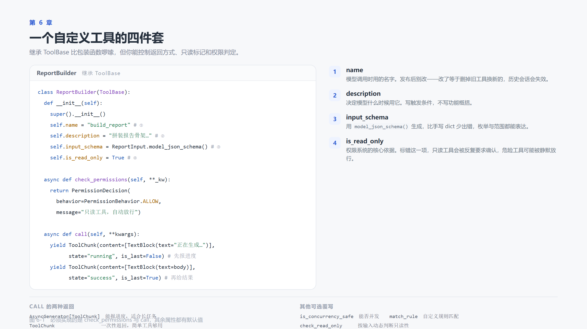
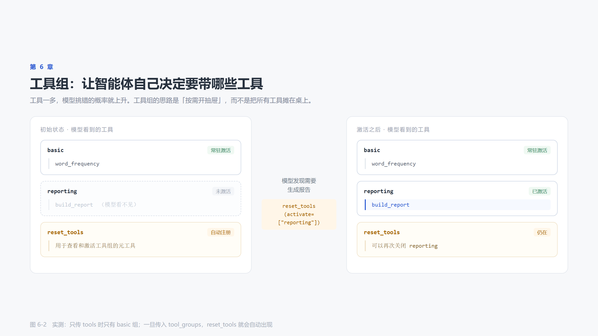

# 第 6 章　工具不够用：自己造

> 本章代码 `code/ch06/main.py`　·　读完约 16 分钟

## 6.0 上一章留下的问题

工作区给了一套通用工具：读、写、编辑、搜索、跑命令。这些足够对付文件，但对付不了你的业务。

真实的场景是这样的：

- 要查内部订单系统，得有 `query_order`
- 要按公司规则算报价，得有 `calc_quote`
- 要把周报按模板排版，得有 `render_weekly`
- 要调用某个内部 HTTP 接口，得有 `call_internal_api`

这些工具框架不会给你，因为它不知道你的业务长什么样。

这一章解决两件事：**怎么写工具**，以及**工具多了之后怎么组织**。

## 6.1 两种写法，先选对

AgentScope 给了两条路，适用场景完全不同：

| | `FunctionTool` | 继承 `ToolBase` |
|---|---|---|
| 代码量 | 一个函数 + docstring | 一个类，两个必实现方法 |
| 参数定义 | 从类型注解推导 | 可以传 Pydantic schema |
| 返回值 | 字符串（或 `ToolChunk`） | 任意 `ToolChunk`，**可流式** |
| 只读标记 | 构造时传 `is_read_only` | 作为属性声明 |
| 权限逻辑 | 统一走"需用户确认" | 可以自定义 |
| 适合 | 纯计算、查表、调接口 | 长任务、有进度、需要精细权限控制 |

判断标准很简单：

> **工具会不会执行超过两秒？会不会产生副作用？会不会需要向用户报进度？**
> 三个里有一个"是"，就用 `ToolBase`。全是"否"，用 `FunctionTool`。

`FunctionTool` 上一章已经用过，这一章重点讲第二种。

## 6.2 用 Pydantic 定义参数

先解决参数定义。手写 JSON Schema 容易出错，用 Pydantic 更稳：

```python
from pydantic import BaseModel, Field

class ReportInput(BaseModel):
    """生成报告的参数。"""

    topic: str = Field(description="报告主题，例如「本周工作」")
    sections: list[str] = Field(
        default_factory=list,
        description="报告的章节名列表，按顺序输出",
    )
    style: str = Field(
        default="markdown",
        description="输出格式，可选 markdown 或 plain",
    )
```

然后 `ReportInput.model_json_schema()` 直接就是工具需要的 `input_schema`。

这样做的好处不只是省事。`Field` 里的 `description` 会成为参数的说明，模型靠它判断"这个参数该填什么"。**参数说明和类型约束写在同一个地方，不会不同步。**

## 6.3 继承 `ToolBase`



一个完整的工具类长这样：

```python
class ReportBuilder(ToolBase):
    def __init__(self) -> None:
        super().__init__()
        self.name = "build_report"
        self.description = (
            "把给定的章节名列表拼成一份报告骨架。"
            "当用户要求「生成报告」「搭个提纲」时使用。"
            "注意：本工具只生成骨架，不会写文件。"
        )
        self.input_schema = ReportInput.model_json_schema()
        self.is_read_only = True
        self.is_concurrency_safe = True

    async def check_permissions(self, **_kwargs) -> PermissionDecision:
        return PermissionDecision(
            behavior=PermissionBehavior.ALLOW,
            message="build_report 是只读工具，自动放行。",
        )

    async def call(self, **kwargs):
        args = ReportInput(**kwargs)
        ...
        yield ToolChunk(
            content=[TextBlock(text=f"正在生成 {len(args.sections)} 个章节…")],
            state="running",
            is_last=False,
        )
        yield ToolChunk(
            content=[TextBlock(text="\n".join(lines))],
            state="success",
            is_last=True,
        )
```

有三个点值得单独说：

### 6.3.1 `check_permissions` 是必须实现的

第一次写自定义工具的人几乎都会撞上这个报错：

```
TypeError: Can't instantiate abstract class ReportBuilder
without an implementation for abstract method 'check_permissions'
```

`ToolBase` 把权限判定设成了抽象方法，强制你表态。这不是刁难——**框架在逼你回答一个问题：这个工具该不该被随便调用？**

只读工具返回 `ALLOW`，有副作用的工具返回 `ASK`（等用户确认），敏感工具返回 `DENY`。第 7 章会展开讲这三个选项的后果。

### 6.3.2 `call` 可以是异步生成器

返回 `ToolChunk` 就结束，或者 `yield` 多个 `ToolChunk` 报告进度。后者的价值在界面上：用户能看到"正在生成 3 个章节…"，而不是一个转圈图标转十秒。

`ToolChunk` 有三个关键字段：

| 字段 | 作用 |
|---|---|
| `content` | 内容块列表，可以含文本，也可以含图片 |
| `state` | `"running"` / `"success"` / `"error"` |
| `is_last` | 是不是最后一块 |

### 6.3.3 `is_read_only` 标错会有实际后果

标成 `True` 但实际会写文件，权限系统会放行它，用户不会收到任何提示。
标成 `False` 但其实是纯计算，用户会被反复打扰。

**这个字段不是文档注释，是运行时行为。**

## 6.4 工具组：别把所有工具摊在桌上

上一章说过一个观察：五个工具时模型选得准，三十个工具时它会挑错。

工具组的思路是**按需开抽屉**：



```python
def build_toolkit() -> Toolkit:
    return Toolkit(
        tools=[
            FunctionTool(word_frequency),        # 进入 basic 组，常驻
        ],
        tool_groups=[
            ToolGroup(
                name="reporting",
                description="报告生成相关工具。用户提到报告、提纲、周报时启用。",
                instructions="生成的报告只是骨架，需要用户补充内容。",
                tools=[ReportBuilder()],
            ),
        ],
    )
```

只传 `tools` 时，那些工具进入特殊的 `basic` 组，永远激活。传入 `tool_groups` 之后，组内的工具默认**不可见**，模型需要先调 `reset_tools` 把它们打开。

实测一下初始状态：

```python
schemas = await toolkit.get_tool_schemas()
print([s["function"]["name"] for s in schemas])
# ['reset_tools', 'word_frequency']
```

注意两件事：

1. `build_report` **不在列表里**——它在未激活的 `reporting` 组中，模型根本不知道它存在
2. `reset_tools` **自动出现了**——你没有定义它。框架检测到存在额外工具组时，会自动注册这个元工具

`reset_tools` 的作用是让模型自己管理工具可见性：查看有哪些组、激活哪些组、关闭哪些组。`ToolGroup` 的 `description` 就是给模型看的说明书——**写得含糊，它就不会去开那个抽屉**。

> **工具组的另一个好处是省 token**
> 每个工具的 schema 都要随每次请求发出去。30 个工具大约是 3000 到 5000 token，每轮都付一次。工具组能让这个数字降到十分之一。

## 6.5 运行结果

自定义工具单独测试（不经过模型）：

```python
tool = ReportBuilder()
async for chunk in tool.call(topic="本周工作", sections=["进展", "问题"]):
    print(chunk.state, chunk.is_last, chunk.content[0].text[:30])
```

```
running False 正在生成 2 个章节…
success True # 本周工作 /  / ## 1. 进展 /  / ## 2. 问题
```

`word_frequency` 的测试：

```python
print(word_frequency("工作 工作 进展 进展 进展 计划"))
# 进展×3、工作×2、计划×1
```

这两个测试**没有调用模型**，是纯粹的 Python 单元测试。这是写工具时的正确姿势：先把工具本身测对，再交给模型。工具自身有 bug 却去调模型，你会在"模型为什么调不明白"和"工具为什么返回错"之间反复兜圈子。

## 6.6 好工具的四条标准

写完十几个工具之后，会总结出这几条：

**1. 描述写触发条件，不写功能概括**

"拼接字符串"是功能，"用户要求生成报告骨架时使用"是触发条件。模型需要的是后者。

**2. 参数有默认值，且默认值合理**

`top_n: int = 5` 比 `top_n: int` 好。模型忘传参数是常事，默认值让它少错一次。

**3. 错误信息写给模型看**

```python
raise ValueError("文件不存在")                         # 模型无从下手
raise ValueError("文件不存在：docs/README.md，可用 Glob 查找目录")   # 模型知道下一步
```

错误信息会进入模型上下文，它是**给模型的提示**，不是给你的日志。

**4. 一个工具只做一件事**

`do_everything(action: str, ...)` 这种设计，模型永远调不对——它得先猜 `action` 该填什么。拆成五个工具，每个名字自解释，反而更省 token。

## 6.7 三个常见错误

**错误 1：忘记调 `super().__init__()`**

```python
def __init__(self):
    self.name = "xxx"    # 报错：缺少 middlewares 属性
```

`ToolBase.__init__` 会初始化中间件链，跳过它后面一定出问题。

**错误 2：`call` 写成普通函数**

```python
def call(self, **kwargs):     # 少写了 async
```

框架会 `await` 它，得到一个 `ToolChunk` 对象而不是协程，报 `TypeError: object ToolChunk can't be used in 'await' expression`。

**错误 3：工具组里的工具忘了写组**

```python
toolkit = Toolkit(tools=[..., ReportBuilder()], tool_groups=[...])
```

把工具同时放进 `tools` 和 `tool_groups`，它会在 `basic` 组里常驻，等于没分组。想让工具按需出现，只能放在组里。

## 6.8 小结

- 两秒以内、无副作用、不需要进度 → `FunctionTool`；否则继承 `ToolBase`
- `check_permissions` 必须实现，框架在逼你表态
- `call` 可以是异步生成器，能报进度
- `is_read_only` 是运行时行为，不是注释
- 工具组让模型自己开抽屉，同时省下大量 token
- 错误信息写给模型看，不是写给自己看

**下一章要解决的问题**：第 6 章我们给工具写了 `check_permissions`，但只是简单返回了 `ALLOW`。如果一个工具真的会删文件，谁来拦？拦下来之后，对话还怎么继续？
